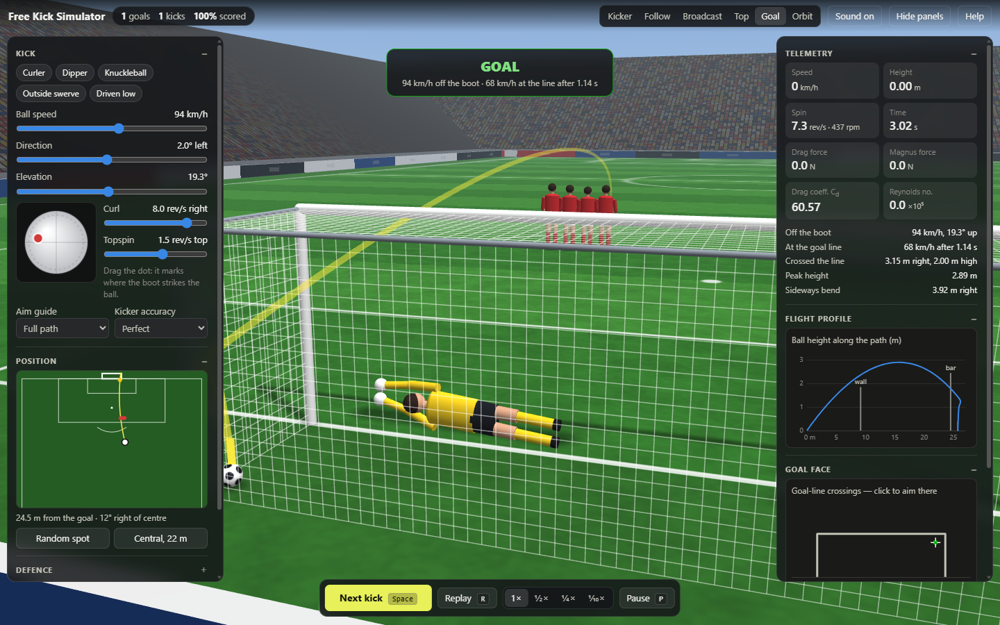

# ⚽ Free Kick Simulator

**A physics-based 3D football free-kick simulator that runs in your browser.** 
Curl it, dip it, or knuckle it past the wall and the keeper. Every flight obeys real aerodynamics.

---

No install, no build step, no dependencies.

**Run it locally:** double-click `index.html` (any current Chrome, Edge, Firefox or Safari).

**Check the physics:** `node tests/physics.test.js` — 29 tests against conservation laws and closed-form results.

## Controls

| Input | Action |
|---|---|
| `Space` | Kick / set up the next kick |
| Arrow keys | Aim direction and elevation (`Shift` = fine steps) |
| `W` `S` · `A` `D` · `Q` `E` | Ball speed · curl left/right · backspin/topspin |
| Drag on the pitch | Aim (or orbit, in the Orbit camera) |
| `1`–`6` | Cameras: kicker, follow, broadcast, top, goal, orbit |
| `R` `P` `M` `H` | Replay in slow motion, pause, mute, hide panels |

Drag the ball on the position map to move the free kick. Click the goal-face chart and the simulator solves the aim
for that spot with your current speed and spin.

## Features

- Ball speed, direction, elevation and spin (sliders, keyboard, or the strike-point pad), with five kick presets
- Live aim guide computed by the same physics engine; optional no-air path for comparison
- Defensive wall (0–6 players, optional jump) placed 9.15 m away covering the near post
- Goalkeeper with reaction time, limited acceleration and reach, and an imperfect read of the shot (three skill levels)
- Wind, air temperature, altitude, humidity, and three playing surfaces
- Telemetry: speed, height, spin, drag and Magnus force, drag coefficient, Reynolds number
- Flight-profile and goal-face charts, kick log (click a row to reload that set-up), CSV export of the trajectory
- Monte Carlo: repeat the kick 300 times with realistic kicker scatter to get a scoring probability
- Six cameras, slow motion, replay, synthesised sound

## Physics model

All SI units; the ball is a 0.43 kg, 0.11 m hollow sphere integrated with 4th-order Runge–Kutta at 1 kHz.

| Effect | Model |
|---|---|
| Gravity | 9.80665 m/s² |
| Drag | `F = ½ρ·Cd·A·v²` against the air-relative velocity. `Cd` follows the drag crisis (≈0.35 below the critical Reynolds number, ≈0.16 above), using the fit of Goff & Carré (2009), plus a small increase with spin |
| Magnus force | `F = ½ρ·Cl·A·v²` along `ω × v`, with `Cl = S/(2.32·S + 0.4)` and spin parameter `S = rω/v` |
| Spin decay | Aerodynamic torque proportional to `ρ·v·ω` (spin falls roughly 7% per second) |
| Knuckle effect | Below about 2 rev/s, a slowly varying side force (peak coefficient 0.13) |
| Air | Density from the ISA barometric formula with a humidity correction; viscosity from Sutherland's law |
| Bounce | Rigid-sphere impulse with restitution and Coulomb friction, coupling linear and angular momentum, so topspin kicks on and backspin checks |
| Rolling | Sliding friction until the ball rolls without slipping, then rolling resistance |
| Goal frame | Posts and crossbar are rigid cylinders; the net is a spring-damper membrane |
| Goal decision | Law 10: the whole ball must cross the line |

**What is approximate.** The lift, spin-drag, spin-decay and knuckle coefficients are empirical fits chosen to sit inside
published wind-tunnel and trajectory ranges for footballs; they are not measurements of a specific ball. The knuckle
effect is a phenomenological model of an inherently chaotic flow. Wind is uniform with height. Players are rigid
capsules and the kicker's foot is not modelled: you set launch speed and spin directly.

## Files

- `js/physics.js` — the engine (also runs in Node)
- `js/render.js` — WebGL2 renderer
- `js/app.js` — controls, cameras, charts, game loop
- `js/audio.js` — sound effects
- `tests/physics.test.js` — validation suite

## License

[MIT](LICENSE). Free to use, modify and share, with no warranty.
