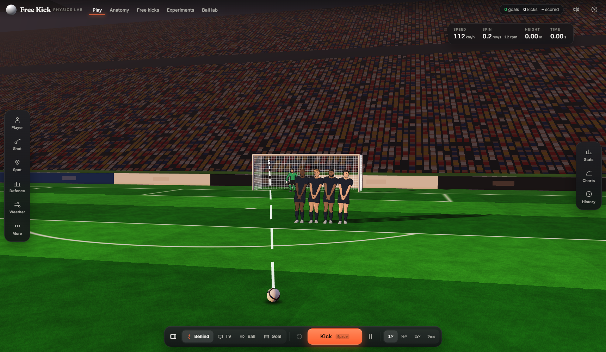

# ⚽ Free Kick Simulator

**A physics-based 3D football free-kick simulator that runs in your browser.** 
Curl it, dip it, or knuckle it past the wall and the keeper. Every flight obeys real aerodynamics.

---

No install, no build step, no dependencies.

**Run it locally:** double-click `index.html` (any current Chrome, Edge, Firefox or Safari).

**Check the physics:** `node tests/physics.test.js` — 29 tests against conservation laws and closed-form results.
All nine suites (103 tests): `for t in tests/*.test.js; do node "$t"; done`

## What's new in v2

- **Real players.** Rigged, cel-shaded figures built from MakeHuman CC0 bodies, one per taker, keeper and wall
  player, dressed in each match's team colours.
- **Motion capture.** The taker's run-up and strike use recorded CMU motion capture, and the boot meets the ball at
  the exact moment the flight simulation starts.
- **Four new sections.** *Anatomy* (a narrated breakdown of one kick), *Free kicks* (12 famous goals recreated),
  *Experiments* (seven controlled physics experiments) and *Ball lab* (four balls with wind-tunnel drag data).
- **Match ball showcase.** The spinning ball in the top-left corner opens a 3-D viewer of World Cup balls, with
  facts about each and a button to play with it.
- **Strike from the boot.** An impact model turns boot speed and contact point into launch speed and spin.
- **A goalkeeper who really dives.** He is now a rigid body that pushes off, flies ballistically and lands, and
  can't change course mid-air.
- **Ten cameras** (up from six), pause-and-orbit mid-flight, and the replay now includes the strike.
- **Two looks.** Illustrated (ink outlines and flat tones) or a realistic stadium at day, sunset or night.
- **New layout.** Two slim icon rails open one focused drawer of controls at a time, with a small live readout.
- **103 tests** across nine suites (v1 had 29).

v1 is still available as the [`v1.0.0`](https://github.com/abahodirov/freekick-simulator/tree/v1.0.0) tag.

**Players** are stylized, cel-shaded rigged figures built from MakeHuman CC0 bodies, one per player: build, height and face traits approximate each footballer, with sculpted hair and beards grown from his own scalp and jaw, painted faces and clean outlines. Every free-kick recreation dresses the taker, wall and keeper in that day's team colours (see `assets/CREDITS.md`, rebuilt with `tools/build_players.py`).
Their skeleton is driven by the simulator's own physics and footwork (`js/people.js`) through retargeting
(`js/rig.js`), and kits, boots, skin tones and hair are painted on per player. If the model file is missing, the
simulator falls back to its built-in sculpted players.

## Controls

| Input | Action |
|---|---|
| `Space` | Kick / set up the next kick |
| Arrow keys | Aim direction and elevation (`Shift` = fine steps) |
| `W` `S` · `A` `D` · `Q` `E` | Ball speed · curl left/right · backspin/topspin |
| Drag on the pitch | Aim (or orbit, in the Orbit camera) |
| `1`–`9`, `0` | Cameras: kicker, follow, broadcast, top, goal, orbit, keeper, side, physics, taker |
| `P` then drag | Pause mid-flight and orbit the ball |
| `R` `P` `M` `H` | Replay in slow motion, pause, mute, hide panels |

Drag the ball on the position map to move the free kick. Click the goal-face chart and the simulator solves the aim
for that spot with your current speed and spin.

## Sections

- **Play** — the simulator.
- **Anatomy** — *The Anatomy of a Free Kick*: a narrated six-scene breakdown of one kick (setup, the player, the
  impact in slow motion with a freeze-frame, the flight with live force arrows, the goalkeeper, the conclusion).
  It has captions, optional voice narration, scene jumps and a timeline scrubber. Every number comes from the
  running simulation.
- **Free kicks** — an exhibition of 12 historic free kicks: Koeman 1992, Roberto Carlos 1997, Mihajlović 1998,
  Beckham 2001, Ronaldinho 2002, Nakamura 2006, Ronaldo 2008 and 2018, Juninho 2009, Pirlo 2013, Bale 2016 and
  Messi 2019. Each case study gives the documented match facts with sources: date, venue, score, minute, distance,
  **the goalkeeper**, **the wall** (where a source records it) and **how the goal went in**. The 3-D recreation
  uses match-style kit colours and name tags over the taker, keeper and wall, and launch values labelled as
  estimates. When you watch a recreation, the goal goes in, as it did.
- **Experiments** — seven controlled experiments (spin vs curve, speed vs drag, backspin vs topspin, the
  knuckleball, wind, ball design, the perfect free kick), with overlaid paths, side- and top-view graphs, a results
  table and CSV export.
- **Strike from the boot** (Kick panel) — an impact model turns boot speed and the contact point into launch speed and
  spin (impulse with restitution; an off-centre hit trades speed for spin).
- **Ball lab** — each ball has its own design on screen (classic panels, six-panel pinwheel, eight-panel with
  triangles, six-panel dark) and a close orbiting camera. The aerodynamics are the engine default ball plus the
  Brazuca, Jabulani and Cafusa, using the drag-crisis values measured
  in a wind tunnel by Hong & Asai (2014, *Scientific Reports* 4:5068) for two panel orientations. It shows Cd
  against speed and runs a same-kick comparison.

- **Match ball** — click the spinning ball at the top left. The ball grows into a large 3-D view you can drag to
  turn, with tabs for other World Cup balls, a few facts about each, and a button to play with it.

Two looks: **Illustrated** (default: ink outlines, flat tones with hatching, a paper-white world, grey defenders)
and **Realistic stadium** (day / sunset / night).

## Features

- Six selectable free-kick takers (Ronaldo, Messi, Roberto Carlos, Beckham, Pirlo, Juninho), each with their own
  footedness, run-up and a signature technique preset. The taker runs up and strikes the ball with real recorded
  motion (CMU motion-capture jog and soccer kicks, rebuilt on each player's proportions), and the boot meets
  the ball at the exact instant the simulation starts. Looks and kits are generic: plain colours, no crests or likenesses.
- Articulated, shaped players: lofted torso, tapered limbs, faces, hair styles, boots, kit patterns and shirt numbers
- Ball speed, direction, elevation and spin (sliders, keyboard, or the strike-point pad), with five kick presets
- Live aim guide computed by the same physics engine; optional no-air path for comparison
- Defensive wall (0–6 players, optional jump) placed 9.15 m away covering the near post
- Goalkeeper as a diving rigid body: reaction time, a set position, a timed take-off, ballistic flight under gravity
  and a landing. He cannot change course in mid-air, and three skill levels set take-off speed and read quality
- Day, sunset and night lighting; clouds, stars, floodlights; an open end with a forest and hills beyond it
- Wind, air temperature, altitude, humidity, and three playing surfaces
- Telemetry: speed, height, spin, drag and Magnus force, drag coefficient, Reynolds number
- Flight-profile and goal-face charts, kick log (click a row to reload that set-up), CSV export of the trajectory
- Monte Carlo: repeat the kick 300 times with realistic kicker scatter to get a scoring probability
- Ten cameras, slow motion, replay (including the strike), synthesised sound

## Physics model

All SI units; the ball is a 0.43 kg, 0.11 m hollow sphere integrated with 4th-order Runge–Kutta at 1 kHz.

| Effect | Model |
|---|---|
| Gravity | 9.80665 m/s² |
| Drag | `F = ½ρ·Cd·A·v²` against the air-relative velocity. `Cd` follows the drag crisis (≈0.35 below the critical Reynolds number, ≈0.16 above), using the fit of Goff & Carré (2009), plus a small increase with spin |
| Magnus force | `F = ½ρ·Cl·A·v²` along `ω × v`, with `Cl = S/(2.32·S + 0.4)` and spin parameter `S = rω/v` |
| Spin decay | Aerodynamic torque proportional to `ρ·v·ω` (spin falls roughly 7% per second) |
| Knuckle effect | Below about 2 rev/s, a slowly varying side force (peak coefficient 0.13) |
| Air | Density from the ISA barometric formula with a humidity correction; viscosity from Sutherland's law |
| Bounce | Rigid-sphere impulse with restitution and Coulomb friction, coupling linear and angular momentum, so topspin kicks on and backspin checks |
| Rolling | Sliding friction until the ball rolls without slipping, then rolling resistance |
| Goal frame | Posts and crossbar are rigid cylinders; the net is a spring-damper membrane |
| Goal decision | Law 10: the whole ball must cross the line |
| Goalkeeper | Centre of mass + body angle + arms in the goal plane. Feet push off for 0.16–0.21 s up to a level-limited launch velocity (lateral 3.7–4.9 m/s, vertical ≤ 2.5–3.3 m/s), then pure projectile motion (gravity only) until the body meets the ground. Take-off is timed so a high ball is met near the top of the jump (flight time ≈ √(2Δz/g)). The ball is caught only if its speed relative to the gloves is below the level's limit, and a caught ball travels with the keeper |

**What is approximate.** The lift, spin-drag, spin-decay and knuckle coefficients are empirical fits chosen to sit inside
published wind-tunnel and trajectory ranges for footballs; they are not measurements of a specific ball. The knuckle
effect is a phenomenological model of an inherently chaotic flow. Wind is uniform with height. Wall players collide
as capsules. The keeper's take-off limits are plausible values for trained keepers, not measurements. The taker's
run-up and strike are animation: you still set launch speed and spin directly, and the signature presets are typical
values for each technique, not measurements of any particular goal.

## Files

- `index.html`, `css/style.css` — the page (open `index.html` directly; no server needed)
- `js/app.js` — controls, charts, game loop
- `js/ui.js` — the layout: icon rails, drawers and the live readout
- `js/physics.js` — the engine, including the goalkeeper body (also runs in Node)
- `js/people.js` — skeletons, poses, keeper dressing, the takers and their run-up animation (also runs in Node)
- `js/render.js` — WebGL2 renderer (stadium, surroundings, lighting presets, people, ball, net)
- `js/cameras.js` — camera rig
- `js/rig.js` — glTF parsing, retargeting our skeleton onto the rigged model, kit regions (also runs in Node)
- `assets/players.js` — the packed CC0 player bodies (generated by `tools/build_players.py`; see `assets/CREDITS.md`)
- `js/sculpt.js` — sculpted body parts (fallback players): head, hair, beard, hands, gloves, boots, and anatomical limb tubes (also runs in Node)
- `js/balls.js`, `js/history.js` — Ball lab and exhibition data, with sources (also run in Node)
- `js/labs.js`, `js/story.js` — Ball lab, Experiments, Free kicks and the Anatomy story
- `js/ballview.js`, `js/showcase.js` — the standalone ball viewer, the spinning logo and the match-ball showcase
- `js/audio.js` — synthesised sound effects
- `assets/mocap.js` — CMU motion-capture clips for the run-up and strike (generated by `tools/mocap_build.js`)
- `assets/balls/` — 3-D ball models (generated by `tools/ball_model.js` and `tools/ball_bake.py`)
- `tests/*.test.js` — physics, regression, force, keeper, people, camera, labs, sculpt and rig suites
- `tools/` — offline build scripts for the players, motion capture and balls (not needed to play)
- `docs/AUDIT.md` — the development audit and roadmap

## References

- Goff, J. E. & Carré, M. J. (2009). Trajectory analysis of a soccer ball. *American Journal of Physics* 77, 1020.
- Hong, S. & Asai, T. (2014). Effect of panel shape of soccer ball on its flight characteristics. *Scientific Reports* 4, 5068.
- Dupeux, G., Le Goff, A., Quéré, D. & Clanet, C. (2010). The spinning ball spiral. *New Journal of Physics* 12, 093004.
- Match facts for the exhibition: see the sources listed on each case study (`js/history.js`).

## Contributors

- [@abahodirov](https://github.com/abahodirov)
- [@TomasPerlovic](https://github.com/TomasPerlovic)

## Credits

Player bodies are from MakeHuman (CC0) and the motion is from the CMU Graphics Lab Motion Capture Database. Ball
models come from third parties under their own licences. Full details are in [`assets/CREDITS.md`](assets/CREDITS.md).

## License

[MIT](LICENSE). Free to use, modify and share, with no warranty.
